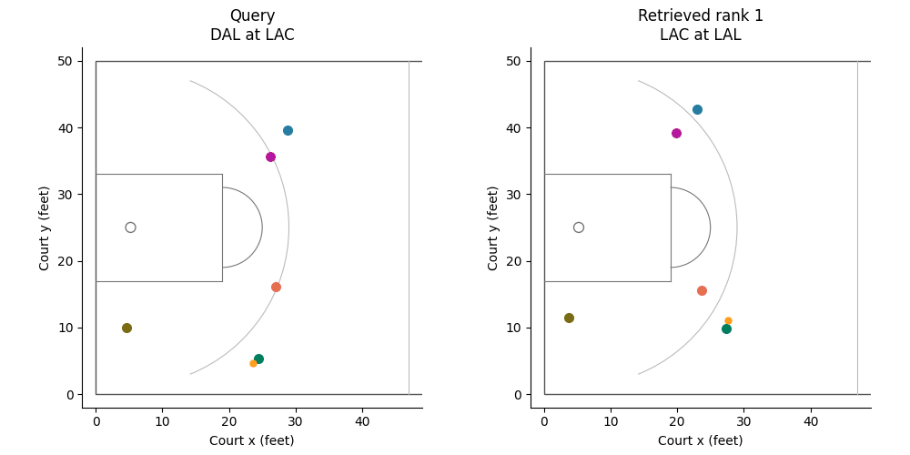

# Approximate Nearest-Neighbor Search for Multi-Curves

Code and reproducibility materials for shifted-grid locality-sensitive hashing of
**multi-curves**, collections of trajectories whose correspondence is unknown.
The distance between two multi-curves is the minimum, over one-to-one curve
matchings, of the largest pairwise discrete Fréchet distance.

**Blocking** divides permutation work between index construction and querying.
For blocks of sizes `b1, ..., bt`, it stores `a = product(bj!)` orders and probes
`b = k! / a` allocations per table. Store-all and Probe-all are its two extreme
cases. The experiments also compare per-curve LSH intersection and per-curve HNSW.

## Basketball retrieval example



Each panel shows five offensive trajectories from a four-second NBA play.
Matching colors indicate the recovered player correspondence. The orange dashed
curve is the ball, shown for context and **excluded from the retrieval distance**.
The two clips are played on the same progress clock for display; the distance
allows each pair of curves its own monotone traversal.

This GIF contains generated court diagrams only. Broadcast video and stills are
not redistributed. See [the animation instructions](docs/BASKETBALL.md) to
regenerate the diagrams or combine them locally with an authorized game video.

## Quick start

Use Linux and Python 3.11 or later. The release was validated with Python 3.14.8;
exact package versions are pinned in [requirements.txt](requirements.txt).

```bash
git clone https://github.com/UIC-InDeXLab/ANN-For-Multi-Curves.git
cd ANN-For-Multi-Curves
python3 -m venv .venv
source .venv/bin/activate
python -m pip install -r requirements.txt

# Small synthetic collection; no external data, video, or TeX required.
NUMBA_NUM_THREADS=2 OPENBLAS_NUM_THREADS=1 OMP_NUM_THREADS=1 \
  python -m reproducibility.demo
```

The demo constructs Blocking, Probe-all, Store-all, and Intersection indexes and
checks their answers against an independent exhaustive matching computation.
It writes [outputs/demo.json](outputs/demo.json). Numba's first compilation can
take substantially longer than subsequent queries; these are not paper timings.

For a small end-to-end test of the subprocess benchmark harness and its raw
result files, run `python -m reproducibility.run smoke --threads 2`. It uses one
seed, three collections of 240 multi-curves, and a separate smoke protocol.

### Tests

```bash
python -m pip install -r requirements-test.txt
NUMBA_NUM_THREADS=2 OPENBLAS_NUM_THREADS=1 OMP_NUM_THREADS=1 \
  python -m pytest -q
```

Most tests use small generated arrays. Tests requiring an existing full corpus
are skipped when it is absent. Paper-font tests require TeX; synthetic kernels,
the demo, and numerical tests do not.

### Inspect the published measurements

[reference_results/](reference_results/) includes aggregate reports, the paper's
tables, and the generated experimental plots. It does not include raw tracking
archives, broadcasts, index binaries, or the multi-gigabyte per-query run
directories.

```bash
python -m reproducibility.verify_reference
python -m reproducibility.render_reference
# Also redraw the plots, with the TeX dependencies described below:
python -m reproducibility.render_reference --figures
```

The second command regenerates 17 tables from the aggregate reports and retains
the recorded scaling table. Its build-time column requires the original
per-seed construction records, which are produced by a fresh benchmark run.
This route verifies and visualizes the **recorded measurements**; it does not
re-run the algorithms or establish new timing results.

## Reproduce experiments

[docs/REPRODUCIBILITY.md](docs/REPRODUCIBILITY.md) describes the run order,
configuration files, data preparation, resource requirements, and commands.
For example:

```bash
# Inspect the protocol without launching an expensive run.
python -m reproducibility.run synthetic --dry-run

# Run all configured synthetic cases sequentially on an otherwise idle machine.
python -m reproducibility.run synthetic --core 0 --threads 8
python -m reproducibility.run scaling --core 0 --threads 8
```

Choose a core in your CPU affinity mask. The wrapper generates ignored working
configs with portable paths and explicit CPU settings. It preserves dataset
seeds, grid searches, tuning/test splits, and selection objectives. Benchmark
runners require a clean Git checkout and record the release revision.

**Full runs are expensive.** The recorded machine had 128 GB RAM. Most studies
allow 24 GB of index storage and up to 48 GB of construction RAM; the largest raw
synthetic collection alone occupies about 20.5 GB. Run only the demo on a small
machine unless you deliberately reduce a protocol and label it as a pilot.
Changed hardware or thread counts will change timings.

For HNSW comparisons, additionally install:

```bash
python -m pip install -r requirements-hnsw.txt
```

The actual HNSW baseline uses `hnswlib`. The exhaustive vector backend used in
some unit tests is not a replacement for HNSW in benchmark results.

## Repository layout

| Directory | Contents |
|---|---|
| [curveset/](curveset/) | Fréchet distance, bottleneck matching, order families, hashing, and index kernels |
| [fresh/](fresh/) | Experiment runners, exact ground truth, tuning, summaries, plotting, and NBA preparation |
| [configs/](configs/) | Seeded protocols for synthetic, real-data, accuracy, sensitivity, and budget studies |
| [reproducibility/](reproducibility/) | Portable wrappers, independent demo, report validation, and local video composition |
| [tests/](tests/) | Unit tests and small synthetic fixtures |
| [reference_results/](reference_results/) | Aggregate measurements, provenance hashes, tables, and curves-only plots |
| [assets/](assets/) | Trajectories-only basketball animation |
| [docs/](docs/) | Reproduction and data/visualization instructions |

The root-level Python scripts are earlier exploratory harnesses kept for
supporting tests. Use the `fresh` runners and `reproducibility` entry points for
the reported evaluation. Some modules support additional exploratory methods;
the comparison in the paper uses the methods named above.

## Scope and reporting

* Main comparisons use **candidate lists** and exact candidate verification.
  **First hit** keeps one identifier per key and returns the first collision
  without verification; it is evaluated separately.
* Parameters are chosen on 500 tuning queries; 1,000 held-out queries measure
  accuracy and latency. Three index seeds share each dataset.
* Recall@1 means an exact nearest-neighbor return. Empty or late answers are
  failures. Latency includes hashing, candidate-list processing, and verification.
* `J_lambda = M / (100 MB) + lambda * T / (1 ms)` selects Blocking's configuration
  from a shortlist. The frontier cloud explores all block partitions; its stars
  use the shortlist selections, matching the other experiments.
* The DTW extension changes pairwise distance, tuning, verification, and ground
  truth. It is empirical; Fréchet approximation guarantees are not asserted for DTW.
* Exact scans are used to establish ground truth and validation, not as a reported
  latency baseline.
* Ten-player NBA results and incomplete first-hit budget follow-ups are not part
  of this release's reported evaluation.

Personal paths and host identifiers have been removed from the exported
reports. [The manifest](reference_results/manifest.json) records hashes for the
released files and, where available, their original byte representations.
Numerical measurements are unchanged.

## Data and third-party resources

NBA preparation downloads the public
[NBA movement archive](https://github.com/sealneaward/nba-movement-data) at pinned
revision `5c9ee6e1387e052c19ab2d22e12120c2210cbe54`.
The archive contains 2015–16 SportVU tracking and event data. Preparation checks
archives, corrects shot anchors, deduplicates timelines, and separates games
before creating the database and query sets.

The dataset, NBA marks, and any broadcasts remain subject to their respective
owners' terms. This repository does not grant redistribution rights to them.
See [NOTICE.md](NOTICE.md). No broadcaster footage or raw NBA corpus is included.
